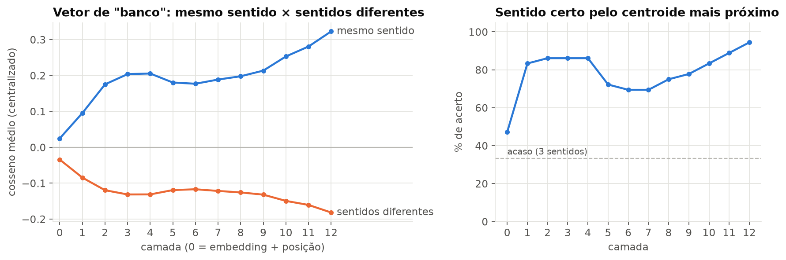
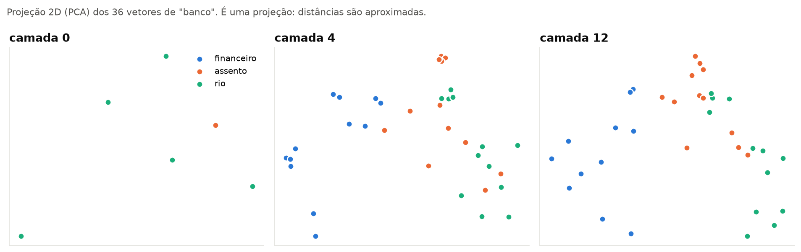
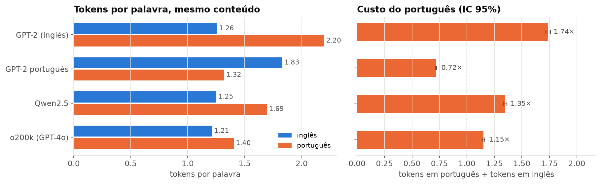
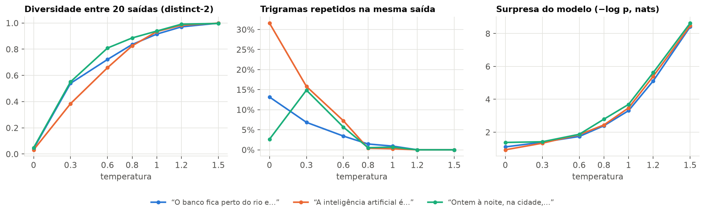
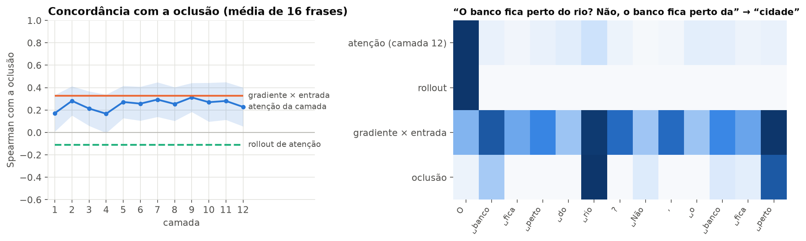

# 🧠 LLMs não pensam em palavras: tokens, embeddings, atenção e probabilidades, medidos

[](https://github.com/YUCAVALCANTE/llm-por-dentro/actions/workflows/ci.yml)
[](https://yucavalcante.com/llm-por-dentro/)


O artigo **"LLMs não pensam em palavras: tokens, embeddings, atenção e probabilidades"** (série **IA sem mágica**, no [Medium](https://medium.com/@yucavalcante)) explica o caminho de uma frase dentro de um modelo de linguagem usando a pergunta *"O banco fica perto do rio?"* e números inventados, avisando que eram ilustrativos. Este repositório refaz o mesmo caminho com **números reais de um modelo de verdade**.

🔎 **[Demo interativa](https://yucavalcante.com/llm-por-dentro/)**: um GPT-2 em português rodando **inteiro no seu navegador**, sem servidor. Você digita uma frase e vê os tokens (com ID e bytes), os vetores projetados em 2D, a atenção de cada camada e de cada cabeça com a máscara causal, e as probabilidades do próximo token com temperatura, top-k, top-p e sorteio com semente, gerando um token de cada vez.

## Resumo dos resultados

| Pergunta do artigo | O que o modelo mostrou |
|---|---|
| O modelo "entende" que *banco* tem vários sentidos? | O vetor de *banco* muda com o contexto. Em 36 frases, o sentido certo (financeiro, assento ou banco de areia) é o do centroide mais próximo em **47%** na entrada (acaso: 33%), **83% já depois da camada 1** e **94% na última camada**. O financeiro se separa cedo; *assento* e *rio* quase não se separam entre si. |
| E em *"O banco fica perto do rio?"*? | No vetor de *banco*, o rio **não entra**: o modelo é causal, e o vetor de *banco* nessa frase é **idêntico** (diferença 0,0) ao de *"O banco aprovou o empréstimo."*. A desambiguação só pode acontecer nos tokens seguintes. |
| Português gasta mais tokens? | Depende do tokenizador. No mesmo conteúdo (960 trechos do WMT24++), o português custa **1,74×** os tokens do inglês no GPT-2 original, **1,35×** no Qwen2.5 e **1,15×** no tokenizador do GPT-4o (o200k). No GPT-2 treinado em português, **0,72×**. |
| O que a temperatura faz? | Temperatura 0 repete até **32%** dos trigramas de uma mesma saída; a partir de 0,8 a repetição praticamente some. Em troca, a "surpresa" do próprio modelo com o texto sobe de **~1 para ~8,5 nats por token** em 1,5, e o texto vira sopa de palavras. |
| O mapa de atenção explica a previsão? | Pouco. A atenção concorda com a oclusão (apagar o token e ver quanto a previsão cai) com Spearman médio de **0,17 a 0,31** por camada, e o token mais atendido na última camada **nunca** foi o mais importante (0 de 16). Motivo principal: **66% da atenção** da última camada vai para o primeiro token, que responde por só **5%** do efeito na oclusão. |

---

## 1. A pergunta

O artigo descreve quatro etapas: **tokens** (o texto vira números), **embeddings** (cada número vira um vetor), **atenção** (os vetores trocam informação) e **probabilidades** (o último vetor vira uma distribuição sobre o vocabulário, e um token é sorteado). As perguntas que viraram experimentos:

1. Em que camada o vetor de *banco* passa a carregar o sentido certo?
2. Quanto custa, em tokens, escrever em português em vez de inglês?
3. O que a temperatura troca: diversidade por quê?
4. Dá para ler o "raciocínio" do modelo no mapa de atenção?

## 2. Modelo usado, e por quê

[`pierreguillou/gpt2-small-portuguese`](https://huggingface.co/pierreguillou/gpt2-small-portuguese) (revisão `89a916c`): GPT-2 small (124 M de parâmetros, 12 camadas, 12 cabeças, vetores de 768 números, vocabulário de 50.257 tokens) ajustado na Wikipédia em português.

- **Licença MIT**: pode ser redistribuído, inclusive em forma convertida.
- **Português de verdade**, com tokenizador próprio: *" banco"* é um token só, o que torna o experimento do *banco* limpo.
- **Pequeno o bastante para o navegador** (~128 MB depois da quantização) e para rodar os experimentos em CPU em poucos minutos.
- **Arquitetura clássica e documentada**, que dá para reescrever em 40 linhas ([`gpt2_puro.py`](python/src/llmlab/gpt2_puro.py)) e conferir contra o `transformers`.

O preço: é um modelo de 2020, pequeno, e escreve mal. Para mostrar *como* um LLM funciona, isso não atrapalha; para medir *quão bem* um LLM atual funciona, atrapalharia (ver Limitações).

## 3. A demo no navegador

```
frase ─► tokenizador (Transformers.js) ─► IDs ─► linhas da matriz de embeddings (int8) ─┐
                                                                                        ▼
                    Web Worker: onnxruntime-web (WASM) roda os 12 blocos do GPT-2 ─► estados de todas as camadas
                                                                                     + atenção [12 camadas × 12 cabeças × T × T]
                                                                                        │
       último estado · cada uma das 50.257 linhas da matriz de embeddings = logits ◄────┘
       logits ÷ temperatura ─► softmax ─► top-k ─► top-p ─► sorteio com semente ─► token entra no contexto
```

- **Exportação própria** ([`exportar.py`](python/src/llmlab/exportar.py)): o ONNX padrão do Transformers.js não devolve a atenção nem os estados intermediários. Aqui o grafo recebe os embeddings e devolve tudo. A matriz de embeddings (que o GPT-2 usa na entrada e na saída, "pesos amarrados") é baixada uma vez só e usada nas duas pontas em JavaScript.
- **Quantização só dos pesos** (int8 por coluna + `DequantizeLinear`): a quantização dinâmica padrão, que também quantiza as ativações, distorcia os pesos de atenção em até 0,46. Com pesos int8 e ativações em float32, o token mais provável é o mesmo do PyTorch em fp32, os logits têm correlação de 0,9995 e a atenção difere em no máximo 0,07 (conferência em [`web/modelo/modelo.json`](web/modelo/modelo.json)).
- **Tempo**: ~128 MB baixados uma vez e guardados no Cache Storage do navegador; numa visita seguinte o modelo fica pronto em 1 a 3 s. Cada passo (rede + logits) leva ~0,2 a 0,3 s num notebook, em WebAssembly com 1 thread.
- A amostragem do navegador ([`amostragem.js`](web/src/amostragem.js)) e a do Python ([`amostragem.py`](python/src/llmlab/amostragem.py)) são a mesma, inclusive o gerador com semente (mulberry32): os testes dos dois lados conferem os mesmos números.

## 4. Experimento 1: em que camada "banco" ganha sentido?

**Protocolo** ([`exp_banco.py`](python/src/llmlab/exp_banco.py)). 36 frases, 12 por sentido, todas **terminando** em *banco*, para que o contexto venha antes da palavra (o GPT-2 só olha para trás). Em cada camada pego o vetor da posição de *banco*, centralizo (subtraio a média das 36 frases; sem isso, todo vetor do GPT-2 aponta quase para a mesma direção) e meço o cosseno médio dentro do mesmo sentido e entre sentidos, e a acurácia de classificar o sentido pelo centroide mais próximo, deixando uma frase de fora por vez.

<p align="center"></p>
<p align="center"></p>

**Leitura.**

1. **Na entrada, *banco* é um vetor só.** Os 47% da camada 0 vêm apenas da posição (as frases de cada grupo têm comprimentos parecidos), não do sentido.
2. **Uma camada de atenção já separa muito** (83%): basta juntar ao vetor de *banco* um pouco de *dinheiro*, *praça* ou *barco*.
3. **No meio da rede a separação cai** (69% nas camadas 6 e 7) e volta a subir até **94%** no fim. Uma leitura possível é que as camadas do meio "reorganizam" o vetor para a tarefa de prever o próximo token; aqui só dá para dizer que a separação não cresce de forma monótona.
4. **O financeiro é o sentido mais distinto** (cosseno com *rio* de −0,38 na última camada); *assento* e *banco de areia* ficam próximos entre si (≈ 0) em todas as camadas: os dois são lugares físicos onde se senta ou se encalha.
5. **Frases ambíguas.** Em *"Sentado à beira do rio, olhei para o banco"*, as camadas 1 a 4 aproximam o vetor de *rio* (a palavra está ali) e, a partir da 5, de *assento* (*sentado* pesa mais). Em *"Depois de pescar no rio, fui ao banco"*, que uma pessoa leria como agência bancária, o modelo fica indeciso: cossenos perto de zero com os três sentidos.
6. **O controle causal:** em *"O banco fica perto do rio?"* o vetor de *banco* é exatamente o mesmo de *"O banco aprovou o empréstimo."*, em todas as camadas. A pergunta do artigo só pode ser resolvida nos tokens que vêm depois.

## 5. Experimento 2: quanto custa o português em tokens?

**Protocolo** ([`exp_tokens.py`](python/src/llmlab/exp_tokens.py)). Corpus paralelo aberto [WMT24++](https://huggingface.co/datasets/google/wmt24pp) (Google, Apache-2.0), par inglês → português do Brasil, 960 trechos com tradução humana em quatro domínios (literário, notícias, redes sociais e fala), 33 mil palavras em cada língua. Quatro tokenizadores; intervalo de 95% por bootstrap de trechos.

<p align="center"></p>

| Tokenizador | Tokens EN | Tokens PT | PT ÷ EN (IC 95%) | Tokens/palavra PT | *"O banco fica perto do rio?"* × *"Is the bank near the river?"* |
|---|---:|---:|---:|---:|---|
| GPT-2 original | 41.780 | 72.656 | **1,74** (1,72–1,76) | 2,20 | 11 × 7 |
| Qwen2.5 | 41.601 | 56.012 | **1,35** (1,33–1,36) | 1,69 | 8 × 7 |
| o200k (GPT-4o) | 40.372 | 46.429 | **1,15** (1,14–1,16) | 1,40 | 7 × 7 |
| GPT-2 português | 60.897 | 43.664 | **0,72** (0,71–0,72) | 1,32 | 7 × 10 |

**Leitura.** O número de palavras é praticamente igual nas duas línguas; a diferença é toda do vocabulário do tokenizador, que reflete os dados em que ele foi treinado. Um tokenizador "inglês" corta *perto* em *per* + *to* e *rio* em *r* + *io*. Pagar 1,74× mais tokens significa pagar mais por chamada de API e caber menos texto na mesma janela de contexto. Tokenizadores multilíngues recentes reduzem a diferença, mas não a zeram. O efeito vale em todos os domínios (1,63× a 2,0× no GPT-2 original; 1,06× a 1,23× no o200k).

## 6. Experimento 3: o que a temperatura troca

**Protocolo** ([`exp_temperatura.py`](python/src/llmlab/exp_temperatura.py)). 3 prompts × 7 temperaturas × **20 sementes**, 40 tokens novos, sem top-k nem top-p. O sorteio é o mesmo da demo. Medidas: diversidade entre as 20 saídas (distinct-2), fração de trigramas repetidos dentro de cada saída e "surpresa" do modelo, isto é, −log p de cada token escolhido segundo o próprio modelo a temperatura 1.

<p align="center"></p>

**Exemplos** (prompt *"O banco fica perto do rio e"*, semente 0):

| T | Continuação |
|---|---|
| 0 | *é um dos mais importantes do país. O Banco do Brasil é o maior banco do país, com mais de 1,5 bilhão de reais…* |
| 0,8 | *tem uma área de 5,8 km². Uma das atrações do complexo é o lago artificial da Água Branca…* |
| 1,5 | *corre em várias vertentes abertas até 1940 à roopiragem imersão a Sampaio pato1898 frequentemente…* |

**Leitura.** Com T = 0 não há sorteio: as 20 sementes dão o mesmo texto, e ele tende a se repetir. Com T baixa (0,3) as saídas já diferem, mas ainda se parecem muito entre si (distinct-2 entre 0,38 e 0,55) e repetem 7% a 16% dos trigramas. Entre 0,6 e 1,0 a repetição some e o texto continua plausível para o modelo. Acima de 1,2, tokens improváveis passam a ser sorteados e cada um puxa o próximo para mais longe: a surpresa média dispara. Temperatura não deixa o modelo "mais criativo"; ela só achata ou afia a mesma distribuição.

## 7. Experimento 4: atenção não é explicação

**Protocolo** ([`exp_atribuicao.py`](python/src/llmlab/exp_atribuicao.py)). 16 frases incompletas; o alvo é o token que o próprio modelo acha mais provável. Para cada token anterior comparo quatro notas de importância: atenção da última posição (média das 12 cabeças, por camada), rollout de atenção (Abnar & Zuidema, 2020), gradiente × entrada e **oclusão** (apagar o token e medir a queda do log p do alvo), que é a referência por mexer na entrada e olhar a saída sem supor nada do mecanismo. Concordância = Spearman com a oclusão, média das 16 frases.

<p align="center"></p>

| Método | Spearman com a oclusão | Acerta o token mais importante |
|---|---:|---:|
| Atenção, por camada | 0,17 a 0,31 | 0 de 16 (camada 12) |
| Atenção, ignorando o 1º token | 0,24 a 0,50 | – |
| Rollout de atenção | −0,11 | – |
| Gradiente × entrada | 0,33 | 8 de 16 |

**Leitura.**

1. **O primeiro token funciona como "ralo" de atenção**: recebe 12% da atenção na camada 1 e 66% a 76% a partir da camada 6, mas apagá-lo mexe pouco na previsão (5% do efeito total). Quando uma cabeça não tem para onde olhar, ela olha para o começo.
2. **Tirando esse ralo, a concordância melhora** (até 0,50), mas continua moderada: muita atenção não significa muita influência, porque o que chega pela atenção ainda passa pelos vetores de valor, pelas projeções e pelo MLP.
3. **O rollout, que deveria resolver isso, piora**: ao multiplicar as camadas, ele acumula o ralo do primeiro token.
4. A demo mostra o ralo em qualquer frase: escolha uma camada do meio e veja a primeira coluna do mapa.

Os alvos também ilustram limites do modelo: *"No inverno faz frio e no verão faz"* → *frio*; *"A capital da França é"* → *Paris*.

## 8. Limitações

- **Um modelo pequeno e antigo.** GPT-2 small (2020), treinado só na Wikipédia em português. Modelos atuais têm vocabulários maiores, mais camadas e outras escolhas (RoPE, atenção agrupada); os fenômenos medidos aqui existem neles, mas os números mudam.
- **Frases escritas por mim.** As 36 frases do *banco* e as 16 da atribuição são poucas e montadas para o experimento; servem para mostrar o efeito, não para estimar com precisão. Os intervalos de confiança só existem no experimento 2.
- **Projeção 2D.** A PCA da demo e da figura mostra só duas direções de 768; as medidas numéricas usam todas as dimensões.
- **Oclusão também é uma escolha.** Apagar um token muda as posições dos seguintes; outras referências (substituir por outro token, *integrated gradients*) dariam números um pouco diferentes.
- **Quantização na demo.** No navegador os pesos são int8: as probabilidades diferem um pouco das do PyTorch (correlação dos logits 0,9995; atenção até 0,07 de diferença). Os experimentos usam o modelo em float32.
- **Ambiguidade de verdade.** O modelo nunca "decide" o sentido de *banco*; ele só acumula informação nos vetores. Chamar isso de entendimento é força de expressão.

## 9. Como reproduzir

```bash
python -m venv .venv && . .venv/bin/activate        # Windows: .venv\Scripts\activate
pip install torch --index-url https://download.pytorch.org/whl/cpu
pip install -e ".[dev,exportar,tokens]"

python -m llmlab.exp_banco          # tudo roda em CPU, em poucos minutos
python -m llmlab.exp_tokens         # baixa o WMT24++ e 3 tokenizadores
python -m llmlab.exp_temperatura
python -m llmlab.exp_atribuicao
python -m llmlab.exportar --saida web/modelo   # ONNX + embeddings int8 + tokenizadores para a demo

pytest -q && ruff check python
node --test "web/test/*.test.js"
node scripts/servidor.mjs 8766      # demo em http://localhost:8766
```

Resultados em `reports/resultados/*.json` e figuras em `reports/figures/`. Os pesos do modelo para a demo ficam fora do Git (são publicados num [Release](https://github.com/YUCAVALCANTE/llm-por-dentro/releases/tag/modelo-v1); o workflow do Pages baixa e confere o SHA-256 de cada arquivo).

## Estrutura

```
python/src/llmlab/
  amostragem.py      temperatura, top-k, top-p e sorteio com semente (igual ao JS)
  gpt2_puro.py       o GPT-2 em ~40 linhas, conferido contra o transformers
  exportar.py        ONNX com atenção e estados + embeddings int8 + tokenizadores
  exp_banco.py · exp_tokens.py · exp_temperatura.py · exp_atribuicao.py
web/
  index.html · estilo.css
  src/app.js             interface (SVG feito à mão, sem bibliotecas de gráfico)
  src/modelo.worker.js   onnxruntime-web num Web Worker, com cache do modelo
  src/amostragem.js · vetores.js · bytes.js   lógica testada com node --test
reports/   figuras e resultados em JSON
```

## Créditos e licenças

Código sob licença MIT. Modelo: [GPT-2 small portuguese](https://huggingface.co/pierreguillou/gpt2-small-portuguese), de Pierre Guillou (MIT), derivado do GPT-2 da OpenAI. Tokenizadores de comparação: [GPT-2](https://huggingface.co/openai-community/gpt2) (MIT) e [Qwen2.5](https://huggingface.co/Qwen/Qwen2.5-0.5B) (Apache-2.0). Corpus: [WMT24++](https://huggingface.co/datasets/google/wmt24pp) (Apache-2.0). Bibliotecas: PyTorch, 🤗 Transformers e Transformers.js, onnxruntime e onnxruntime-web.
